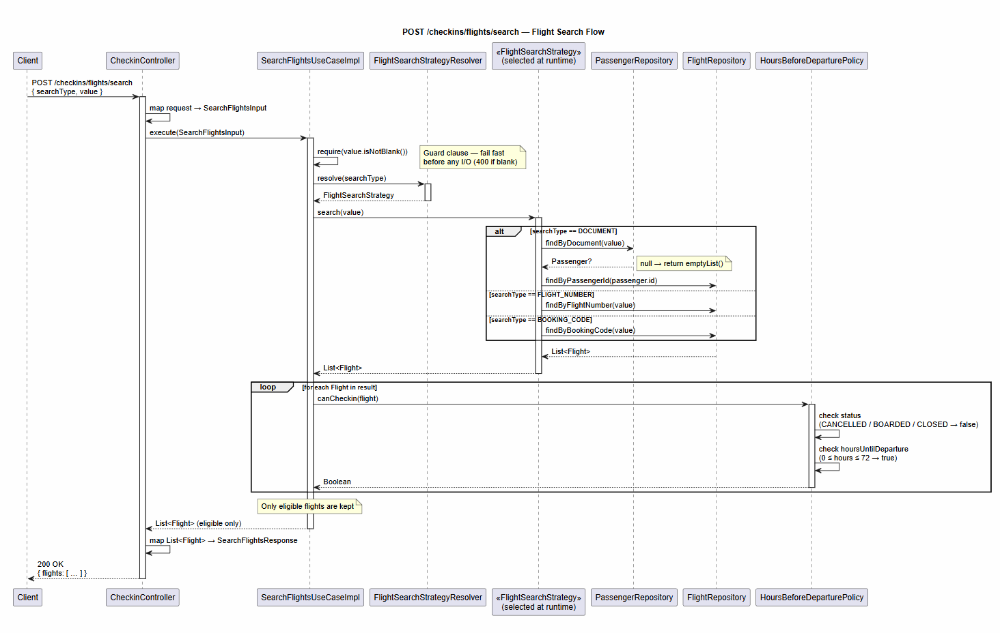

# ✈️ MaiaFlight — Check-in API

Digital passenger check-in backend for MaiaFlight.  
**Stack:** Kotlin · Spring Boot 4 · Spring MVC · Virtual Threads (Project Loom)  
**Architecture:** Clean Architecture · Use Case pattern · Strategy pattern · SOLID

---

## Table of Contents

- [Overview](#overview)
- [Architecture](#architecture)
- [Layer Responsibilities](#layer-responsibilities)
- [Endpoints](#endpoints)
- [Design Decisions](#design-decisions)
- [Applied Patterns](#applied-patterns)
- [Thread Safety & Concurrency](#thread-safety--concurrency)
- [Observability](#observability)
- [Virtual Threads](#virtual-threads-project-loom)
- [Testing](#testing)
- [Running Locally](#running-locally)
- [Sequence Diagrams (UML)](#sequence-diagrams-uml)

---

## Overview

Passengers check in up to **72 hours** before departure by locating their booking through one of three strategies:

| Search type | Example value |
|---|---|
| Flight number | `MF100` |
| Booking code (locator) | `ABC123` |
| Personal document (CPF) | `123.456.789-00` |

After a successful check-in, a domain event is published so downstream services can send the boarding confirmation e-mail.

---

## Architecture

```
┌────────────────────────────────────────────────────────────────┐
│                           api/                                  │
│  CheckinController     implements CheckinsApi (OpenAPI)        │
│  GlobalExceptionHandler  translates exceptions → HTTP status   │
└───────────────────────────────┬────────────────────────────────┘
                                │ input objects
┌───────────────────────────────▼────────────────────────────────┐
│                       application/                              │
│  SearchFlightsUseCase   (interface)                            │
│  PerformCheckinUseCase  (interface)                            │
│  impl/  SearchFlightsUseCaseImpl                               │
│  impl/  PerformCheckinUseCaseImpl                              │
│  input/ SearchFlightsInput · PerformCheckinInput               │
│  port/  FlightRepository · PassengerRepository                 │
│         CheckinRepository · EventPublisher  (interfaces)       │
└───────────────────────────────┬────────────────────────────────┘
                                │ domain objects
┌───────────────────────────────▼────────────────────────────────┐
│                         domain/                                 │
│  model/    Flight · Passenger · Checkin · FlightStatus         │
│  policy/   CheckinPolicy ◄── HoursBeforeDeparturePolicy        │
│  strategy/ FlightSearchStrategy ◄── FlightNumberSearchStrategy │
│                                ◄── BookingCodeSearchStrategy   │
│                                ◄── DocumentSearchStrategy      │
│            FlightSearchStrategyResolver                        │
│  event/    CheckinCompletedEvent                               │
└───────────────────────────────┬────────────────────────────────┘
                                │ implements ports
┌───────────────────────────────▼────────────────────────────────┐
│                     infrastructure/                             │
│  InMemoryFlightRepository   InMemoryPassengerRepository        │
│  InMemoryCheckinRepository  LoggingEventPublisher              │
└────────────────────────────────────────────────────────────────┘
                                │ wires everything
┌───────────────────────────────▼────────────────────────────────┐
│                       config/                                   │
│  ApplicationConfig   @Bean declarations (no Spring in domain)  │
└────────────────────────────────────────────────────────────────┘
```

---

## Layer Responsibilities

### `api/` — HTTP Adapter

| Class | Responsibility |
|---|---|
| `CheckinController` | Accept requests, map to input objects, delegate to use cases, map results to response models. Contains **no business logic**. |
| `GlobalExceptionHandler` | Translate domain exceptions into standardised HTTP status codes and error bodies. |
| `DomainExceptions` | Typed exception hierarchy: `FlightNotFoundException`, `PassengerNotFoundException`, `CheckinNotAllowedException`, `CheckinAlreadyExistsException`. |

### `application/` — Use Case Orchestration

| Class | Responsibility |
|---|---|
| `SearchFlightsUseCase` | Interface declaring the flight-search contract. |
| `PerformCheckinUseCase` | Interface declaring the check-in contract. |
| `SearchFlightsUseCaseImpl` | Validates input → resolves strategy → searches → filters by policy. |
| `PerformCheckinUseCaseImpl` | Loads resources → applies policy → atomic save → publishes event. |
| `SearchFlightsInput` / `PerformCheckinInput` | Immutable value objects carrying use case input data. |
| `port/*` | Output port interfaces (repositories, event publisher) — the domain never imports infrastructure. |

### `domain/` — Business Rules

| Class | Responsibility |
|---|---|
| `Flight`, `Passenger`, `Checkin` | Immutable domain entities modelled as `data class`. |
| `FlightStatus`, `SearchType` | Type-safe enums preventing stringly-typed bugs. |
| `CheckinPolicy` | Interface: is a flight eligible for check-in right now? |
| `HoursBeforeDeparturePolicy` | Implements the 72-hour window rule and status guard. |
| `FlightSearchStrategy` | Interface: find flights by a given search criterion. |
| `FlightNumberSearchStrategy` | Finds flights by exact flight number. |
| `BookingCodeSearchStrategy` | Finds flights by booking code (PNR locator). |
| `DocumentSearchStrategy` | Finds flights by passenger CPF/passport via `PassengerRepository`. |
| `FlightSearchStrategyResolver` | Resolves the correct strategy from `SearchType` at runtime. |
| `CheckinCompletedEvent` | Immutable domain event carrying email and flight ID for downstream consumers. |

### `infrastructure/` — Adapters (Implements Ports)

| Class | Responsibility |
|---|---|
| `InMemoryFlightRepository` | Thread-safe in-memory flight store (read-only; pre-loaded sample data). |
| `InMemoryPassengerRepository` | Thread-safe in-memory passenger store (read-only; pre-loaded sample data). |
| `InMemoryCheckinRepository` | `ConcurrentHashMap`-backed store; `saveIfAbsent` is atomic (see [Thread Safety](#thread-safety--concurrency)). |
| `LoggingEventPublisher` | Publishes events to SLF4J logs. Replace with `KafkaEventPublisher` for production. |

---

## Endpoints

Full contract: [`src/main/resources/openapi/check-in-api.yaml`](src/main/resources/openapi/check-in-api.yaml)

### `POST /checkins/flights/search`

Searches for flights available for check-in.

**Request body**
```json
{
  "searchType": "FLIGHT_NUMBER",
  "value": "MF100"
}
```

`searchType` values: `FLIGHT_NUMBER` | `BOOKING_CODE` | `DOCUMENT`

**Response `200 OK`**
```json
{
  "flights": [
    {
      "flightId": "FL-001",
      "flightNumber": "MF100",
      "origin": "GRU",
      "destination": "JFK",
      "departureTime": "2026-04-04T14:00:00Z",
      "checkinAvailable": true
    }
  ]
}
```

---

### `POST /checkins`

Performs a passenger check-in.

**Request body**
```json
{
  "flightId": "FL-001",
  "passengerId": "P-001"
}
```

**Response `201 Created`**
```json
{
  "checkinId": "550e8400-e29b-41d4-a716-446655440000",
  "status": "CONFIRMED",
  "boardingGate": "A1",
  "boardingTime": "2026-04-04T13:30:00Z"
}
```

**Error responses**

| HTTP status | Trigger |
|---|---|
| `400 Bad Request` | Search value is blank |
| `404 Not Found` | Flight or passenger does not exist |
| `409 Conflict` | Check-in window closed, flight cancelled, or duplicate check-in |

---

## Design Decisions

### Why `POST` and not `GET` for the flight search?

A `GET /checkins/flights/search?type=DOCUMENT&value=123.456.789-00` would violate OWASP:

1. **Sensitive data in URLs**: personal document numbers (CPF, passport) appear in server access logs, browser history, and proxy caches in plain text — even over HTTPS.
2. **Structured payload**: the `searchType` + `value` pair is an object with semantics. A JSON body models it more clearly than query parameters, and future optional filters (e.g., date range) are added without breaking the API contract.
3. **Consistency**: both endpoints mutate or query state based on a structured request — `POST` keeps the API semantically uniform.

> Reference: [OWASP — Sensitive Data in Query Strings](https://owasp.org/www-community/vulnerabilities/Information_exposure_through_query_strings_in_url)

---

### Immutability with `data class` and `val`

All domain entities are declared as `data class` with only `val` fields:

```kotlin
data class Flight(
    val id: String,
    val flightNumber: String,
    val departureTime: LocalDateTime,
    val status: FlightStatus,
    val passengerIds: List<String>
)
```

**Why it matters:**
- **Thread safety**: immutable objects can be safely shared across concurrent virtual threads without locks or synchronisation.
- **Predictability**: `HoursBeforeDeparturePolicy.canCheckin(flight)` can never mutate the `flight` it receives — it is a pure function.
- **Safe equality**: `data class` generates `equals`/`hashCode` from all fields, making domain objects safe to use in collections and Kotest matchers.
- **Controlled updates**: any modification produces a new object via `copy()`, making state changes explicit and traceable.

---

### Use Case pattern vs. Command pattern

The previous implementation used a generic `CommandHandler<C, R>` interface. This was replaced with specific use case interfaces for the following reasons:

| Concern | Command pattern | Use Case pattern |
|---|---|---|
| Readability | `handler.handle(SearchFlightsCommand(...))` — generic, requires knowing types | `useCase.execute(SearchFlightsInput(...))` — self-documenting |
| Discoverability | `CommandHandler<C, R>` with type erasure — IDE autocomplete less helpful | `SearchFlightsUseCase.execute(...)` — types are explicit |
| Complexity | Extra level of indirection (Command object + CommandHandler interface + impl) | Input object + interface + impl — one less layer |
| DIP compliance | Both honour DIP equally | Both honour DIP equally |

The use case pattern maintains the same architectural guarantees (DIP, SRP, OCP) with less indirection.

---

### Trade-offs: In-Memory vs Database

| Aspect | In-Memory (current) | Database (production) |
|---|---|---|
| Setup | Zero infrastructure | PostgreSQL + Flyway migrations |
| Persistence | Lost on restart | Durable |
| Concurrency | `ConcurrentHashMap.putIfAbsent` (CAS) | DB transaction + unique constraint |
| Integration tests | Instantaneous | Requires Testcontainers |
| Swap effort | Change one `@Bean` in `ApplicationConfig` | Change one `@Bean` in `ApplicationConfig` |

The port interfaces (`FlightRepository`, `PassengerRepository`, `CheckinRepository`) are the boundary. Swapping `InMemoryFlightRepository` for a JPA implementation requires changing **only** `ApplicationConfig` — no domain or use case code changes.

---

### Trade-off: Event publication without Outbox

The `PerformCheckinUseCaseImpl` publishes `CheckinCompletedEvent` **after** the repository save:

```
saveIfAbsent(checkin) → true → publish(CheckinCompletedEvent)
```

**Risk**: if `publish` throws after a successful save, the check-in record exists but the confirmation e-mail is never sent.

**Mitigation for production**: implement the [Transactional Outbox Pattern](https://microservices.io/patterns/data/transactional-outbox.html) — persist the event in the same database transaction as the check-in, then use a relay (Debezium, polling) to publish it to the broker. The `EventPublisher` interface makes this change transparent to the use case.

---

### Boarding time rule

Boarding time is set to `departureTime - 30 minutes`. This is a hardcoded business rule.  
If it needs to vary per flight type or airline tier, extract it to a `BoardingTimePolicy` interface following the same pattern as `CheckinPolicy`.

---

## Applied Patterns

### Strategy — Flight Search

```
SearchFlightsUseCaseImpl
    → FlightSearchStrategyResolver.resolve(searchType)
        → FlightNumberSearchStrategy | BookingCodeSearchStrategy | DocumentSearchStrategy
```

Each strategy implements one algorithm for locating flights. Adding a new `SearchType` requires only a new strategy class and a new `Map` entry in `ApplicationConfig` — existing strategies and the use case are untouched (**Open/Closed Principle**).

### Policy — Check-in Eligibility

```kotlin
interface CheckinPolicy {
    fun canCheckin(flight: Flight): Boolean
}
```

`HoursBeforeDeparturePolicy` implements the 72-hour window and flight status checks. Changing the rule (e.g., to 48 hours) or adding a new rule (e.g., VIP passengers can check in 96 hours early) requires a new implementation — the use case never changes (**Open/Closed Principle**).

### Use Case — Orchestration

Each use case interface exposes a single `execute` method and is responsible for exactly one business operation. The controller and infrastructure code depend on interfaces, not on implementations (**Dependency Inversion Principle**).

---

## Thread Safety & Concurrency

### The TOCTOU problem

A naive duplicate check implementation:
```kotlin
// UNSAFE — two threads can both pass this check
if (!checkinRepository.exists(flightId, passengerId)) {
    checkinRepository.save(checkin)  // both may reach this line
}
```

Two concurrent requests for the same passenger/flight pair would both read "no duplicate" and both proceed to save, creating two check-in records.

### The solution: atomic `saveIfAbsent`

`InMemoryCheckinRepository` uses `ConcurrentHashMap.putIfAbsent`, which is a single atomic CAS (compare-and-swap) operation:

```kotlin
val existing = checkinByFlightAndPassenger.putIfAbsent(compositeKey, checkin)
// null  → key was absent → record saved → return true
// value → key existed   → duplicate   → return false
```

Because the entire check-then-insert is a single hardware-level atomic operation, exactly one of two racing threads will receive `null` (success) and the other will receive the existing entry (duplicate). No locks, no synchronised blocks, no contention — the approach scales naturally under virtual threads.

In a database-backed implementation, the equivalent guarantee is provided by a `UNIQUE` constraint on `(flight_id, passenger_id)` combined with an `INSERT ... ON CONFLICT DO NOTHING` or a database transaction with a unique index violation caught as a `DataIntegrityViolationException`.

---

## Observability

### Structured logging

Spring Boot 4 ships native ECS (Elastic Common Schema) structured logging. Configured in `application.yaml`:

```yaml
spring.logging.structured.format.console: ecs
```

All log statements follow the `action=<verb> field=value` pattern for easy filtering:

```
action=search_flights_start    searchType=FLIGHT_NUMBER  value=MF100
action=strategy_resolved       strategy=FlightNumberSearchStrategy
action=search_flights_completed totalFound=1  eligible=1

action=perform_checkin_start   flightId=FL-001  passengerId=P-001
action=checkin_policy_rejected flightId=FL-003  flightStatus=CANCELLED
action=checkin_saved           checkinId=abc123  boardingGate=A1
action=checkin_event_published checkinId=abc123  passengerEmail=joao@email.com
```

Filter examples for Kibana / Loki:
- `action: "checkin_saved"` → all completed check-ins
- `action: "checkin_policy_rejected"` → eligibility failures (monitor for spikes)
- `action: "checkin_duplicate_rejected"` → concurrent duplicate attempts

### Actuator endpoints

| Endpoint | Description |
|---|---|
| `GET /actuator/health` | Application and component health status |
| `GET /actuator/info` | Version, JVM, and build metadata |
| `GET /actuator/metrics` | Micrometer metrics (JVM, threads, HTTP requests) |
| `GET /actuator/mappings` | All registered HTTP routes |
| `GET /actuator/loggers` | Read and change log levels at runtime |
| `GET /actuator/env` | Active configuration properties |

**Change log level without restarting:**
```bash
curl -X POST http://localhost:8080/actuator/loggers/com.dowglasmaia.checkinapi \
  -H "Content-Type: application/json" \
  -d '{"configuredLevel": "DEBUG"}'
```

**Add Prometheus scraping (future):**
```xml
<dependency>
    <groupId>io.micrometer</groupId>
    <artifactId>micrometer-registry-prometheus</artifactId>
</dependency>
```
Enables `GET /actuator/prometheus` — scrape-ready for Prometheus + Grafana dashboards.

---

## Virtual Threads (Project Loom)

```yaml
server:
  tomcat:
    threads:
      virtual:
        enabled: true
```

### Why virtual threads?

| | Platform threads | Virtual threads |
|---|---|---|
| Managed by | Operating system | JVM |
| Memory per thread | ~1 MB stack | ~1 KB heap |
| Practical limit | Thousands | Millions |
| Blocking I/O behaviour | OS thread blocked (idle) | Thread parked (unmounted), OS thread freed |

The check-in flow performs sequential blocking calls: repository lookup → policy evaluation → repository save → event publish. With virtual threads:

- Each request gets its own virtual thread.
- While waiting for I/O, the virtual thread is parked and the underlying carrier thread is released for other work.
- Far more concurrent requests can be served with the same hardware, without reactive programming or `async`/`await` refactoring.
- Code remains sequential and readable.

> **Spring Boot 4 guidance**: Virtual threads are the recommended approach for Spring MVC REST APIs on Java 21+. WebFlux/coroutines are preferred when the reactive model is required end-to-end (streaming, backpressure).

---

## Testing

Unit tests use **Kotest 5.9.1** (FunSpec / BehaviorSpec) and **MockK 1.13.12**.  
No Spring context is loaded — classes are instantiated directly.

```
src/test/kotlin/
├── domain/policy/
│   └── HoursBeforeDeparturePolicyTest     BehaviorSpec   7 scenarios
├── domain/strategy/
│   └── FlightSearchStrategyTest           FunSpec        6 scenarios
└── application/usecase/
    ├── SearchFlightsUseCaseTest           FunSpec        8 scenarios
    └── PerformCheckinUseCaseTest          FunSpec        9 scenarios
```

**Test isolation:** every test class uses `beforeTest { clearMocks(...) }` to reset MockK expectations before each test, preventing expectation bleed between test cases.

```bash
# Run all tests
./mvnw test

# Run a specific spec
./mvnw test -Dtest=HoursBeforeDeparturePolicyTest

# Run with verbose output
./mvnw test -Dsurefire.useFile=false
```

---

## Running Locally

**Prerequisites:** Java 21+

```bash
# Generate OpenAPI code + compile + run tests
./mvnw clean test

# Start the application
./mvnw spring-boot:run
```

The API is available at `http://localhost:8080`.

### Example requests

```bash
# Search by flight number
curl -X POST http://localhost:8080/checkins/flights/search \
  -H "Content-Type: application/json" \
  -d '{"searchType": "FLIGHT_NUMBER", "value": "MF100"}'

# Search by document (CPF)
curl -X POST http://localhost:8080/checkins/flights/search \
  -H "Content-Type: application/json" \
  -d '{"searchType": "DOCUMENT", "value": "123.456.789-00"}'

# Perform check-in
curl -X POST http://localhost:8080/checkins \
  -H "Content-Type: application/json" \
  -d '{"flightId": "FL-001", "passengerId": "P-001"}'

# Health check
curl http://localhost:8080/actuator/health
```

**Sample data available in local mode:**

| Passenger ID | Document | Flights |
|---|---|---|
| P-001 | 123.456.789-00 | FL-001 (MF100, GRU→JFK, +24h), FL-002 (MF200, CGH→LHR, +48h) |
| P-002 | 987.654.321-00 | FL-001 |
| P-003 | 111.222.333-44 | FL-003 (MF300, GIG→MIA, +100h — outside 72h window) |

---

## Sequence Diagrams (UML)

### `POST /checkins/flights/search`


---

### `POST /checkins`


---

## Project Structure

```
src/main/kotlin/com/dowglasmaia/checkinapi/
├── api/
│   ├── controller/    CheckinController
│   └── exception/     DomainExceptions · GlobalExceptionHandler
├── application/
│   ├── port/          FlightRepository · PassengerRepository
│   │                  CheckinRepository · EventPublisher
│   └── usecase/
│       ├── input/     SearchFlightsInput · PerformCheckinInput
│       ├── impl/      SearchFlightsUseCaseImpl · PerformCheckinUseCaseImpl
│       SearchFlightsUseCase · PerformCheckinUseCase  (interfaces)
├── config/            ApplicationConfig
├── domain/
│   ├── event/         CheckinCompletedEvent
│   ├── model/         Flight · Passenger · Checkin · FlightStatus · SearchType
│   ├── policy/        CheckinPolicy · HoursBeforeDeparturePolicy
│   └── strategy/      FlightSearchStrategy · FlightSearchStrategyResolver
│                      FlightNumberSearchStrategy · BookingCodeSearchStrategy
│                      DocumentSearchStrategy
└── infrastructure/
    ├── messaging/     LoggingEventPublisher
    └── repository/    InMemoryFlightRepository · InMemoryPassengerRepository
                       InMemoryCheckinRepository
```
