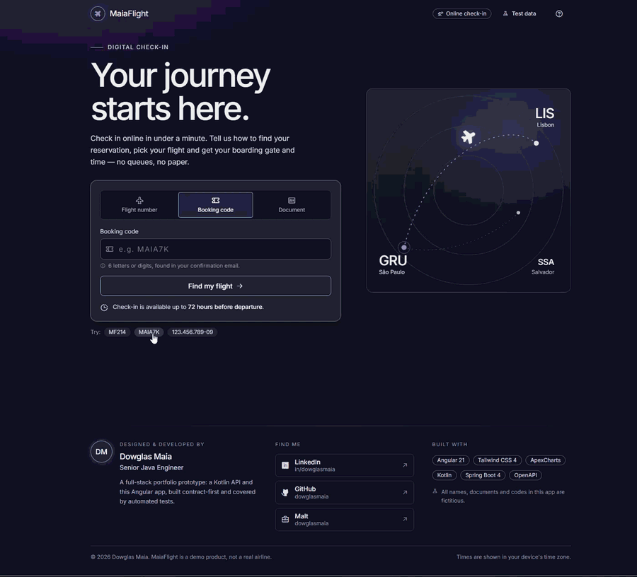

# ✈️ MaiaFlight Check-in

> A full-stack online check-in for a fictitious airline: a **Kotlin / Spring Boot** API and an **Angular** web app, built contract-first, tested end to end and developed with **Claude Code** as an AI pair programmer.




## 📚 Table of Contents

- [About the project](#-about-the-project)
- [Technologies](#-technologies)
- [Architecture](#-architecture)
- [Repository layout](#-repository-layout)
- [Getting started](#-getting-started)
- [Trying the flow](#-trying-the-flow)
- [The API at a glance](#-the-api-at-a-glance)
- [The web app at a glance](#-the-web-app-at-a-glance)
- [Quality](#-quality)
- [Built with an AI assistant](#-built-with-an-ai-assistant)
- [Decisions and known limits](#-decisions-and-known-limits)
- [Documentation](#-documentation)
- [Author](#-author)

## 🧭 About the project

Passengers find their reservation, pick a flight and get a **boarding gate and boarding time** — no queues, no paper. The rules live in the API; the app only shows what the API says.

- **Three ways to find a flight:** flight number, booking code or personal document.
- **Check-in window:** open from **72 hours before departure** until departure.
- **Honest availability:** flights whose check-in is not open yet, or that were cancelled, are listed too, with the reason, instead of silently disappearing.
- **No duplicates:** the same passenger cannot check in twice on a flight, even under concurrent requests.
- **Stable errors:** every failure carries a machine-readable `code`, so the app never guesses from message text.
- **Built to be demoed:** fictitious seed data, a **Test data** page with ready-made scenarios and a one-click reset.

> All names, documents and codes are **fictitious**. MaiaFlight is a demo product, not a real airline.

## ⚡ Technologies

**Backend** — `api-check-in-api-kotlin`


**Frontend** — `app-check-in-api-angular`


**Platform and delivery**


**AI-assisted development**


| Area | What is used | Why |
|---|---|---|
| API | Kotlin 2.2, Spring Boot 4, Spring MVC on **virtual threads**, Java 24+ | Idiomatic, concise backend; high concurrency without reactive code |
| Contract | **OpenAPI 3** + openapi-generator (`interfaceOnly`) | The spec is the source of truth: controllers implement the generated interfaces |
| Design | Clean Architecture, Use Case, **Strategy** (search), **Policy** (eligibility), ports and adapters | Business rules independent of HTTP and storage |
| Observability | Structured JSON logs (ECS) with a `requestId`, Actuator health/info/metrics | Correlate a request across front and back; no personal data in logs |
| Web app | Angular 21: standalone components, **signals**, **Signal Forms**, zoneless, lazy routes, View Transitions | Modern, small, testable |
| UI | Tailwind CSS 4 with the **Nocturne** design tokens, Phosphor icons, self-hosted Inter | A consistent dark design system, no CDN at runtime |
| Charts | ApexCharts, lazy loaded, only with real flow data | Check-in windows, window progress, journey timeline |
| Tests | Kotest + MockK + MockMvc (API); Vitest + TestBed (app) | Fast unit tests plus HTTP and component behaviour |
| Delivery | Docker multi-stage images (non-root), nginx reverse proxy, GitHub Actions, Dependabot | One command to run everything, same origin so no CORS |

## 🏗 Architecture

```
 Browser ──►  nginx (app container) ──┬──►  Angular SPA (static files, no-cache index, hashed assets)
                                      │
                                      └──►  /checkins · /demo · /actuator/health
                                                       │
                                                       ▼
                                  Spring Boot API (Kotlin, virtual threads)
                                                       │
                                  api ► application ► domain ◄ infrastructure
                                  (controllers)  (use cases,    (in-memory repositories,
                                                  ports)         seed data, event logger)
```

- **Same origin.** The app container serves the SPA and reverse-proxies the API, so the browser never needs CORS. In development, `ng serve` does the same through `proxy.conf.js`.
- **The API is the authority.** The app does not duplicate business rules: it asks, and renders `checkinAvailable`, `checkinOpensAt` and error `code`s.
- **Per-feature modules in the app.** `check-in` (the journey) and `test-data` (demo scenarios), each with its routes and a `doc.md`; modules talk through small public APIs.

Deeper dives: [API architecture, patterns and concurrency](api-check-in-api-kotlin/README.md) · [app structure and rules](app-check-in-api-angular/README.md).

## 🗂 Repository layout

```
.
├── api-check-in-api-kotlin/      Kotlin + Spring Boot API (own README, Dockerfile, OpenAPI spec)
├── app-check-in-api-angular/     Angular web app (own README, Dockerfile, nginx config)
├── docs/
│   ├── frontend-integration-guide.md   Contract, flows, errors and test data for front-end work
│   ├── api-audit-report.md             Audit findings, fixes and decisions
│   ├── assets/                         Demo GIF
│   └── MaiaFlight check-in prototype/  Visual prototype and the Nocturne design system
├── .github/                      CI workflow and Dependabot
└── docker-compose.yml            API + app, one command
```

## 🚀 Getting started

### Everything with Docker

```bash
docker compose up --build
```

Open <http://localhost:4200> (`APP_PORT` changes the port). The API is not published to the host; the app container reaches it on the internal network.

### Local development

Requirements: **JDK 24+** and **Node 24+**.

```bash
# terminal 1: API on http://localhost:8080
cd api-check-in-api-kotlin && ./mvnw spring-boot:run

# terminal 2: app on http://localhost:4200 (proxies to the API through proxy.conf.js)
cd app-check-in-api-angular && npm ci && npm start
```

If the API runs elsewhere: `API_URL=http://localhost:18080 npm start`.

### Useful configuration

| Variable | Where | Effect |
|---|---|---|
| `APP_DEMO_ENABLED` | API | `false` removes `GET /demo/test-data` and `POST /demo/reset` (default `true`) |
| `CORS_ALLOWED_ORIGINS` | API | Browser origins allowed; empty keeps CORS off (not needed with the proxy) |
| `LOG_FORMAT` / `LOG_LEVEL` | API | Log format (`ecs` JSON by default) and level |
| `API_UPSTREAM` / `API_BASE_URL` | App container | nginx upstream and the runtime `apiBaseUrl` served in `/config.json` |
| `API_URL` | `npm start` | Target of the dev-server proxy |

## 🧪 Trying the flow

The API ships **fictitious** data and lists ready-made scenarios at `GET /demo/test-data`; the app shows them on the **Test data** page.

| Search | Value | Result |
|---|---|---|
| Flight number | `MF214` | 1 flight, check-in open |
| Booking code | `MAIA7K` | 3 flights: open, not open yet, cancelled |
| Document | `123.456.789-09` | 3 flights; the passenger is identified automatically |

On a flight found by booking code or flight number, the confirm panel lists the flight's fictitious passengers and pre-fills the first one, so the whole flow can be completed without knowing the data.

The API keeps check-ins **in memory**, so the same passenger cannot check in twice on the same flight. To repeat the flow use **Reset test data** (Test data page, or the "already checked in" screen), which calls `POST /demo/reset`; restarting the API also works. Never type real personal data while testing.

## 🔌 The API at a glance

| Method | Path | Purpose |
|---|---|---|
| `POST` | `/checkins/flights/search` | Find flights by flight number, booking code or document. Returns flights that have not departed, each with `checkinAvailable`, `status`, `checkinOpensAt`; `passengerId` for document searches |
| `POST` | `/checkins` | Check a passenger in; `201` with gate, boarding time and confirmation id |
| `GET` | `/demo/test-data` | Fictitious scenarios and passengers (can be disabled) |
| `POST` | `/demo/reset` | Forget every check-in (can be disabled) |
| `GET` | `/actuator/health` | Liveness and readiness |

Errors share one body, `{ status, error, message, code }`, with codes such as `FLIGHT_NOT_FOUND`, `PASSENGER_NOT_ON_FLIGHT`, `CHECKIN_NOT_ALLOWED` and `CHECKIN_ALREADY_DONE`. Full contract: [OpenAPI spec](api-check-in-api-kotlin/src/main/resources/openapi/check-in-api.yaml) and the [integration guide](docs/frontend-integration-guide.md).

## 🖥 The web app at a glance

- **Journey:** search → flights → details/confirm → boarding pass, with a progress stepper, skeleton loading, view transitions and a screen for each error case.
- **Design system:** Nocturne tokens in Tailwind 4, outlined buttons, focus rings, responsive from phone to desktop, `prefers-reduced-motion` respected.
- **Charts, only where there is data:** check-in windows per flight, a window-progress ring with a live `d HH:MM:SS` countdown, and the check-in → boarding → departure timeline.
- **Privacy by design:** nothing is written to `localStorage`/`sessionStorage`; a typed document goes to the API and is kept only as a masked label (`•••.456.789-••`) in memory. No personal data in logs.
- **Accessibility:** skip link, labelled landmarks, `aria-live` status updates, keyboard-friendly dialogs and controls.
- **Security headers:** the nginx image sends a strict CSP (`default-src 'self'`), `X-Frame-Options`, `nosniff` and a no-referrer policy.

## ✅ Quality

At the time of writing: **72 backend tests** and **230 frontend tests**, all passing.

| Project | Commands |
|---|---|
| API | `./mvnw -B verify` (generates the OpenAPI interfaces, compiles, runs the tests) |
| App | `npm run format:check` · `npm test` · `npm run build` · `npm audit --omit=dev --audit-level=high` |
| Both | Dependency review on pull requests, Docker image builds, weekly Dependabot |

The workflow in [`.github/workflows/ci.yml`](.github/workflows/ci.yml) runs only the job of the project whose folder changed, with Maven, npm and Docker layer caching, and also checks that the production `index.html` has no inline event handlers (the CSP would block them).

Highlights of what the tests cover: the 72-hour boundaries with a fixed clock, 32 concurrent check-ins for the same passenger (exactly one wins), every HTTP error and its `code`, personal data never reaching logs or storage, and each screen of the journey including the unavailable and already-checked-in cases.

## 🤖 Built with an AI assistant

This project was developed with **[Claude Code](https://claude.com/claude-code)**, Anthropic's command-line AI coding assistant, working as a pair programmer under the direction and review of the author. The assistant did the heavy lifting; the decisions, scope and acceptance were human.

| Phase | What the assistant helped with |
|---|---|
| **Audit** | Read the whole API, found real defects (any passenger could check in on any flight, inactive validation, exposed Actuator endpoints, personal data in logs, an off-by-hours check-in window, timezone mislabeling) and fixed them with regression tests |
| **Infrastructure** | Structured JSON logging with request correlation, Dockerfiles, nginx reverse proxy and CSP, CI with path filters, Dependabot |
| **Contract and docs** | Evolved the OpenAPI spec compatibly, wrote the audit report and the front-end integration guide from behaviour confirmed in code and in running requests |
| **Front end** | Analysed the visual prototype, mapped its gaps against the API, then built the Angular app with the Nocturne design system, charts and tests |
| **Verification** | Ran builds and tests, drove the real app in a browser (desktop and mobile), reproduced reported bugs before fixing them, and rebuilt the Docker stack |

How the work was steered:

- **Plan first.** Larger changes started in plan mode: explore, compare options, agree on the approach, only then implement.
- **Skills and conventions.** The Angular work followed the Angular developer skill (standalone components, signals, Signal Forms, Vitest) and a module-per-feature structure.
- **Evidence over claims.** Nothing counts as done until the build, the tests and a real run say so; failures, skipped checks and trade-offs are reported rather than hidden.
- **Reported bugs are reproduced first.** For example, the "second check-in gets stuck" problem was reproduced in the browser and traced to the API's in-memory check-ins and the app forgetting them, then fixed on both sides.

AI assistance does not replace review: treat this repository as a worked example of AI-assisted engineering, not as unreviewed generated code.

## 🧩 Decisions and known limits

| Topic | Decision or limit |
|---|---|
| Persistence | **In memory on purpose**: a portfolio prototype that runs with one command and deterministic seed data. The repository ports isolate storage, so PostgreSQL (unique `(flight_id, passenger_id)`, Flyway) can be added behind them without touching the use cases |
| Authentication | **None yet.** Identifiers are guessable and endpoints are anonymous; this is the main gap before real use (JWT/OIDC and ownership checks are the next step) |
| Time | The API works in UTC; the app shows times in the device's time zone, because the API does not send the airport's zone |
| Events | The "check-in completed" event is only logged, with the e-mail masked. A real broker would call for the outbox pattern |
| Boarding pass | A visual preview: no PDF or QR code yet |
| Boarding time | Fixed at 30 minutes before departure; can fall in the past if the check-in is made late |
| Searching by document | The API matches the exact format; the app adds the usual CPF mask when 11 digits are typed |

More in the [audit report](docs/api-audit-report.md) and the pending items at the end of the [integration guide](docs/frontend-integration-guide.md).

## 📖 Documentation

| Document | What it covers |
|---|---|
| [`api-check-in-api-kotlin/README.md`](api-check-in-api-kotlin/README.md) | API architecture, layers, patterns, concurrency, observability, tests |
| [`app-check-in-api-angular/README.md`](app-check-in-api-angular/README.md) | App scripts, structure, configuration, privacy |
| [`features/check-in/doc.md`](app-check-in-api-angular/src/app/features/check-in/doc.md) · [`features/test-data/doc.md`](app-check-in-api-angular/src/app/features/test-data/doc.md) | Responsibility, routes, rules and dependencies of each app module |
| [`docs/frontend-integration-guide.md`](docs/frontend-integration-guide.md) | Endpoints, DTOs, errors, flows, test data and open questions |
| [`docs/api-audit-report.md`](docs/api-audit-report.md) | Findings by priority, fixes, contract changes, persistence decision |
| [`check-in-api.yaml`](api-check-in-api-kotlin/src/main/resources/openapi/check-in-api.yaml) | The OpenAPI contract |
| [`CLAUDE.md`](CLAUDE.md) | Context and conventions for AI assistants working in this repository |
| [`docs/MaiaFlight check-in prototype`](docs/MaiaFlight%20check-in%20prototype) | The visual prototype and the Nocturne design system |

## 👨‍💻 Author

**Dowglas Maia** — Senior Java Engineer

[](https://www.linkedin.com/in/dowglasmaia/)
[](https://github.com/dowglasmaia)
[](https://www.malt.com/profile/dowglasmaia)
